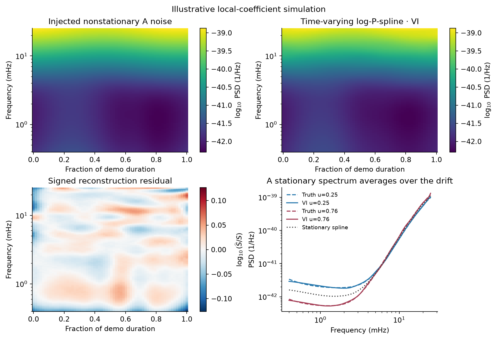
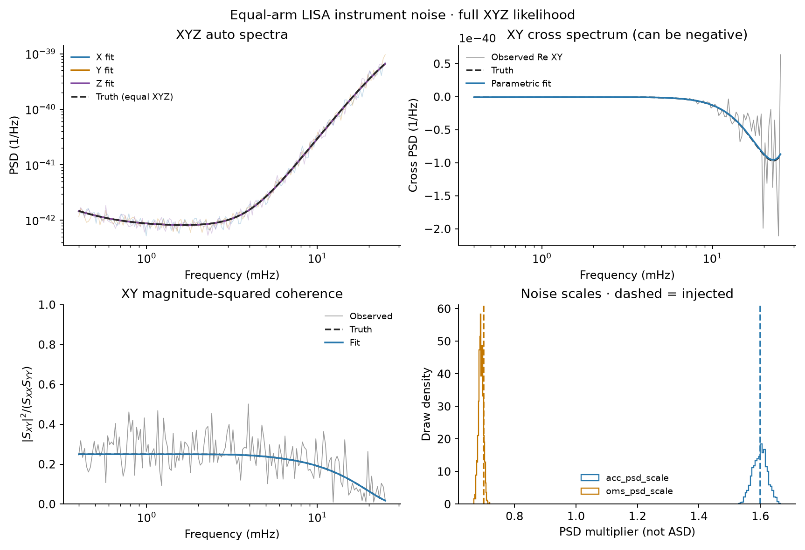

# LISA case studies for LogPSplinePSD

Small, runnable examples for the [LogPSplinePSD documentation](https://nz-gravity.github.io/LogPSplinePSD/).
Start with the first two cases; each makes its own seeded synthetic data,
runs a fit, and saves a comparison figure and a reproducibility receipt.
The third case is an orbit-response and gap-conditioning prototype. Default
runs require no archived paper data, ephemeris download, or cluster account.

| Case | What it teaches | Run |
|---|---|---|
| [Time-varying A noise](scripts/01_time_varying_noise.py) | Recover a changing PSD with a tensor log-P-spline; compare with a stationary spline on fixed held-out rows | `uv run lisa-demo-time` |
| [Correlated XYZ noise](scripts/02_xyz_parametric_noise.py) | Fit acceleration and OMS noise levels with the full spectral matrix; inspect auto spectra, cross spectra and coherence | `uv run lisa-demo-xyz` |
| [Orbit response and gaps — prototype](docs/gapped_xyz.md) | Seven-day orbit-derived TDI-2 reference and GapLike window conditioning; full per-bin XYZ point fits | `uv run --extra gapped lisa-demo-gaps` |

## Quick start

Requires Python 3.12+ and [uv](https://docs.astral.sh/uv/).

```sh
git clone https://github.com/nz-gravity/logpsplines_lisa_case_studies.git
cd logpsplines_lisa_case_studies
uv sync --locked
uv run python scripts/01_time_varying_noise.py --quick
uv run python scripts/02_xyz_parametric_noise.py --quick
```

`--quick` is a small execution check. For the illustrated settings, run the
commands without it and choose fresh output directories if outputs exist:

```sh
uv run lisa-demo-time --output outputs/time_standard
uv run lisa-demo-xyz --output outputs/xyz_standard
```

Both scripts accept `--seed` and `--output`. Existing output directories are
never overwritten. The console entry points and numbered scripts run the
same code. The library is pinned to an exact Git commit in `pyproject.toml`;
`uv.lock` fixes the separate demo environment. The paper reproduction
environment is not used or changed.

## 1. Nonstationary A-channel instrument noise

The acceleration and optical-metrology-system (OMS) components have
different, smooth time-dependent PSD multipliers. The example generates
independent local real Gaussian coefficients, sums their squared values,
and fits `PowerData` with `PowerConfig(method="vi")`. It compares a
time-varying tensor model with the constant-time-basis stationary model.

Every fourth time row is held out using a fixed rule. Truth is used only for
plots and recovery scores. Neither truth nor held-out powers sets the
numerical scaling or spline knots. VI output is an exploratory point
reconstruction; no calibrated uncertainty claim is made.



Outputs include `comparison.png`, `data.npz`, two `PSDResult` files,
`elbo.npz`, `errors.json` and `run.json`. The `.nc` files use LogPSplinePSD's
HDF5-backed result format: read them with `PSDResult.from_netcdf`. Their
spectra use the numerical normalization recorded as `data.npz["scale"]`;
multiply by that value for physical PSD units. The figure and saved point
estimates in `data.npz` are already in physical units.

## 2. Parametric, correlated XYZ instrument noise

The equal-arm covariance is

`S_XYZ(f) = acc_psd_scale × S_acc(f) + oms_psd_scale × S_oms(f)`.

The two scales multiply **PSD**, not amplitude spectral density. The script
simulates proper complex Gaussian XYZ vectors and fits both positive noise
scales with two NumPyro NUTS chains. Its model includes the full covariance,
including cross spectra. Known-baseline whitening improves conditioning and
preserves the matrix likelihood up to a parameter-independent constant.

`ParametricSpectrum` in the pinned library handles independent channel
powers. This example instead supplies a small full-matrix adapter using the
library's `wishart_log_likelihood` and NUTS runner. It does not treat XYZ as
independent. Equal arms make the injected cross spectra real; complex sample
cross spectra still fluctuate around that value.



Outputs include `comparison.png`, `data.npz`, `posterior.nc`,
`sample_stats.nc`, `parameters.json` and `run.json`. The receipt records
R-hat, effective sample size and divergences. Quick-mode draw summaries are
for execution checking; inspect diagnostics and chain agreement before
interpreting posterior uncertainty.

## Scope and next cases

The first two cases use a deliberately simple observation model:
equal-arm, first-generation Michelson instrumental spectra with SciRDv1 noise
levels. They simulate independent spectral coefficients directly, rather
than running a time-domain TDI simulator or a WDM transform. The illustrative
time drift is prescribed, not an orbital noise prediction. See
[model conventions and sources](docs/models.md).

The [seven-day gaps prototype and implementation notes](docs/gapped_xyz.md)
start the orbit-response and gap-conditioning work. This does not yet claim
validated time-varying spline recovery with gaps.

The next additions I would make are:

1. A multivariate **spline reconstruction of the same XYZ data**, using the
   parametric spectrum as a baseline and deliberately misspecifying it.
2. A Galactic foreground plus instrument-noise example with orbital
   modulation, building on the [time-varying paper reproduction](https://github.com/nz-gravity/lisa_timevarying_logpsplines_study).
3. A gapped-data case that preserves time coordinates and transform masks.

Keep paper-scale sensitivity studies and cluster jobs in their study repos;
link them from here. This repo should remain easy to install and quick to run.

## Development

```sh
uv run pytest -q
uv run ruff check .
uv run ruff format --check .
```

Tests check the analytic XYZ formulas, coefficient normalization, positive
definiteness, and the full matrix likelihood and gradients against an
independent log-determinant/solve calculation. Large output files are ignored;
the two small README previews are retained in `docs/assets/`.

With `uv sync --extra gapped --locked`, `uv run --extra gapped pytest -q`
also runs the orbit-response and GapLike integration checks. The gap prototype
retains its own clearly labeled preview in the implementation notes.

The case studies live at
[nz-gravity/logpsplines_lisa_case_studies](https://github.com/nz-gravity/logpsplines_lisa_case_studies).
The [library-link note](docs/link_from_library.md) records the links from the
LogPSplinePSD documentation and README.
