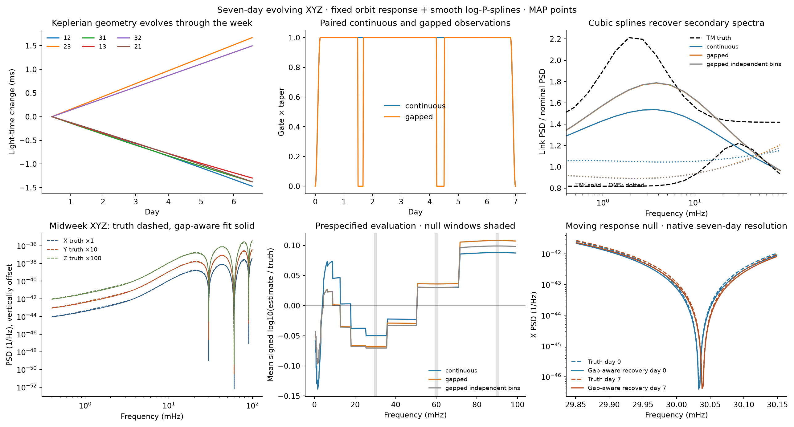

# Exact compressed gap benchmark

The main seven-day case uses a [full matrix reference correction](reference_matrix.md).
This retained benchmark combines a known orbit response with two smooth learned
secondary-noise spectra and its own fixed prior. GapLike provides the masks and windows. Its
stationary scalar likelihood is not used as though it were a correlated,
nonstationary XYZ likelihood; the joint feature covariance is constructed here.

## Simulator and observation operator

Let $c$ index TM/OMS, $e$ index orbit epochs, and $H_{e,c}(f)$ be the
3×6 response from independent link sources to XYZ. The mixing and TM link
covariance follow Eqs. 2, 9 and 28–29 of
[Noisy Pipelines I](https://arxiv.org/html/2610.28726v1).
Independent stationary real link sources have one-sided spectra

$$P_c(f_j)=P_{c,0}(f_j)\exp\{B_{b(j)}\beta_c\}.$$

Here $b(j)$ is a declared source-frequency band; the library's cubic basis
$B$ is evaluated at its centre in log frequency. Latent positive-frequency
coefficients are proper complex Gaussian with covariance
$N P_c(f_j)/(2\Delta t)$. DC is zero. Nyquist uses a real draw and the real
response, following the real-FFT convention explicitly.

The evolving output and measured feature vector are

$$x(t)=\sum_e a_e(t)\sum_c\operatorname{irfft}\{H_{e,c}\,n_c\}(t),$$

$$y_w=\begin{bmatrix}\Re z_w\\\Im z_w\end{bmatrix},\qquad
z_w=\sqrt{2\Delta t/N}\;R\,\operatorname{rfft}\{w(t)x(t)\}.$$

The piecewise-linear weights $a_e$ sum to one. They extend constantly
beyond the first and last epoch centres. $R$ selects the fixed Fourier bins;
$w$ includes the actual gap gate and taper. Because the same $n_c$ appears
at every epoch, epoch cross terms are retained.

## Covariance bank

Writing $L_{w,c,b}$ for the real linear map from standardized independent
link-noise coordinates in source band $b$ to $y_w$ gives

$$C_w(\beta)=\sum_{c,b}\exp\{B_b\beta_c\}\,
 C_{w,c,b},\qquad C_{w,c,b}=L_{w,c,b}L_{w,c,b}^{T}.$$

The implementation accumulates these banks by Fourier convolution of
$w(t)a_e(t)$, streaming source frequencies in chunks. The response is
computed on the native seven-day grid. It retains all channel, frequency,
quadrature and epoch cross terms. Negative-frequency contributions and the
real Nyquist endpoint are explicit. Thus no independent-bin or
proper-complex approximation enters the continuous or gapped joint fit.

The real Gaussian log likelihood is

$$\log L=-\tfrac12\{\log|C_w|+y_w^T C_w^{-1}y_w\}+\mathrm{constant}.$$

Nominal-covariance whitening is fixed before fitting and independent of
injected truth. It changes the likelihood only by a parameter-independent
constant. The proper prior is

$$\beta_c\sim N(0,Q^{-1}),\qquad Q=10P+I/0.8^2,$$

where $P$ is the library's trace-normalized derivative penalty. MAP
optimization includes the quadratic prior penalty; the prior determinant
is constant because $Q$ is fixed. Three starts must agree to $10^{-5}$ in
objective and have maximum absolute gradient below $2\times10^{-4}$.
Failure raises an error rather than publishing a failed fit.

## Scope of exactness

The likelihood is exact for the **retained real feature vector under this
discretized simulation**. It compresses a much larger observation and loses
information. It is not an exact full-time-series likelihood or an
end-to-end LISA simulator. A latent Fourier representation imposes periodic
source covariance; edge tapers reduce boundary sensitivity without removing
that modeling choice. Quasi-static epoch filters approximate evolving
noncommuting TDI delays. There is no filtering, decimation, aliasing or
foreground model. These restrictions are shared by injection and recovery.

The independent-bin comparison zeros only inter-frequency covariance
blocks, retaining each real/imaginary XYZ block. It is fitted as an
approximation and evaluated on independent data with the full covariance.

The beta weights here are secondary log-PSD corrections. They are not the
Cholesky regression theta coefficients analytically integrated in the main
library fit. The benchmark has fewer observations, a narrower model and a
different prior. Compare its exact versus independent-bin controls within
`benchmark_errors.json`; do not interpret its RMSE versus full matrix VI as
a controlled comparison of likelihoods.

## Independent checks

`tests/test_joint_gaussian.py` constructs an independent dense time-domain
operator by propagating every real latent Fourier coordinate through the
epoch filters. Its gapped covariance agrees with the streamed bank,
including nonzero cross-frequency and quadrature blocks. Other checks verify
that identical epoch filters collapse to the stationary case and that
changing filters change the simulated record.

The optimized objective is checked against an independent dense
log-determinant/solve calculation including the proper prior, with a
finite-difference stationarity check. Earlier scientific contracts verify
the equal-arm TDI-2 limit, complex spectral symmetry, real-series coefficient
normalization, matrix window convolution, the library Wishart likelihood
and gradients, and an exact stationary GapLike likelihood-difference control.

## Saved benchmark controls

The standard seed-7 controls use the same 48 bins, seven basis functions per
secondary component, fixed prior and three MAP restarts. Their auto-spectrum
log10 RMSE is 0.0633 for continuous data, 0.0738 for the exact gapped fit,
and 0.0699 for the gapped independent-bin approximation. In this realization,
retaining the exact covariance does not improve the point RMSE over that
approximation. This is not a posterior calibration study.

The [benchmark receipt](../assets/seven_day_benchmark_run.json) and
[benchmark errors](../assets/seven_day_benchmark_errors.json) retain all controls,
null-window residual scores, optimizer checks and independent predictive
scores. These numerical targets are distinct from the full matrix VI fit.
