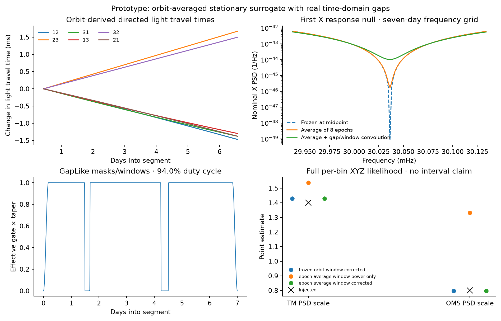

# Toward a seven-day, gapped XYZ spline case

This is a working **response/window prototype**, not a completed validation
of time-varying spline inference with gaps.

## The useful idea from Noisy Pipelines I

[Burke et al., arXiv:2610.28726v1](https://arxiv.org/html/2610.28726v1)
analyse four seven-day segments from a 30-day simulation. Their secondary
noise spectra are stationary, while unequal, evolving light travel times
make the TDI response nonstationary. They average the **covariance kernels**
over eight epochs per segment and include the conditioning of the data.
The seven-day choice does not eliminate response-zero drift. Their example
has no gaps.

For our case, use a known response

`S_XYZ(t,f) = K_TM(t,f) S_TM(t,f) + K_OMS(t,f) S_OMS(t,f)`.

The kernels come from six directed, orbit-derived light travel times and
the TDI-2 mixing matrix. The positions of the dips are not additional sine
fit parameters. Average `M C_link Mᴴ`, rather than averaging `M` before
forming its covariance. A smooth log-P-spline should learn noise spectral
shape or a residual around this physical reference.

## Run the prototype

```sh
uv sync --extra gapped --locked
uv run --extra gapped lisa-demo-gaps --quick --output outputs/gaps_quick
uv run --extra gapped lisa-demo-gaps --output outputs/gaps_standard
```

Both use seven days at a five-second cadence: 120,960 samples and native
Fourier spacing `1/(7 days) ≈ 1.65 microHz`. Quick mode sparsifies inference
bins; it does not change the duration or pretend a short record has weekly
frequency resolution. Standard mode uses all retained analysis-band bins.

The default physical Keplerian orbit model is an offline approximation.
To use the paper's kind of ephemerides, add `--orbit esa`; this fetches
version 1.0.0 ESA trailing orbits through lisaorbits. The default Keplerian
case has been run; the ESA download path is optional and is not represented
as having been run.

The prototype:

1. Samples six directed light travel times at eight epochs and the midpoint.
2. Constructs full complex XYZ TDI-2 TM/OMS reference matrices, retaining
   their cross spectra and comparing midpoint versus epoch-averaged geometry.
3. Draws a **stationary circulant surrogate** with the averaged covariance.
   This tests the proposed locally stationary likelihood approximation;
   it is not an end-to-end time-varying TDI simulation.
4. Uses [GapLike](https://github.com/gaplike/gaplike) to construct two real
   time-domain gaps, taper their edges, and transform the windowed XYZ data.
5. Convolves every matrix element with the exact window-power kernel. The
   negative-frequency extension preserves complex cross-spectrum symmetry.
6. Fits two PSD-scale parameters using a full **per-bin** XYZ likelihood,
   comparing geometry/conditioning approximations. It supplies point
   estimates only; this stage does not fit spline coefficients.

Outputs are `comparison.png`, `reference.npz`, `point_fits.json` and
`run.json`. The receipt records the orbit model, cadence, eight-epoch setup,
gap intervals, duty cycle, source hashes, versions and explicit limitations.
The likelihood's mean whitened quadratic at a fitted common amplitude is
constrained by its score equation, so it is **not an independent validation**.



In the saved seed-7 stationary-surrogate run, the window-corrected point
estimates are TM=1.429 and OMS=0.797 for injections 1.4 and 0.8. Window-power
rescaling alone gives TM=1.538 and OMS=1.332. This is one realization of the
surrogate model, not an ensemble calibration or evidence that the combined
time-varying spline problem has been solved. In this gapped example, window
mixing dominates the response-zero depth; the frozen-geometry and
epoch-averaged, window-corrected fits are very close.

## Why GapLike is useful, and what remains

GapLike's current likelihood and CG interfaces use stationary component
covariances. Multiple input channels are independent with identical
covariances. That does not directly represent unequal-arm, correlated XYZ.
Its masks, windows, normalization and exact stationary controls are useful
building blocks; its scalar convolved diagonal is cross-checked against all
our matrix auto spectra.

The matrix window calculation is the exact *same-frequency* covariance for
the stationary surrogate. The fit still drops gap-induced *cross-frequency*
correlations and the real-data pseudo-covariance. No calibrated uncertainty
claim follows from it. No filtering, decimation, or aliasing chain is
simulated, so this is not a reproduction of the paper's conditioned data.

Before calling the combined demonstration successful:

- Add a genuinely time-varying XYZ time-domain generator and propagate the
  actual observation/conditioning operators into its covariance.
- Fit smooth secondary-noise spectra through the orbit kernels, or smooth
  matrix corrections around an independently specified orbit reference.
  Keep priors and knot placement independent of injected spectral truth.
- Compare continuous data, naive gapped Whittle, window-corrected point
  fits, and a joint channel/frequency gap-aware covariance benchmark.
- Validate on independent noise realizations and show all auto spectra,
  complex cross spectra, coherence and residuals near all response nulls.

For a cheap conservative first spline route, keep only complete local
transform windows and preserve their original time coordinates. This loses
data around each gap, but avoids treating a zero-filled FFT as independent
observations. An exact multichannel gap-aware route requires an explicit
block-covariance/operator extension; it is not obtained by passing XYZ into
GapLike's independent-channel interface.

## Checks implemented

`tests/test_orbit_gaps.py` verifies the equal-arm TDI-2 limit, covariance
epoch averaging, complex cross spectra, matrix-valued window convolution
against a dense time-domain covariance calculation, and GapLike's exact
stationary likelihood differences against an independent dense Cholesky
calculation. The dense comparison also demonstrates the nonzero
cross-frequency blocks omitted by the point-fit approximation.
